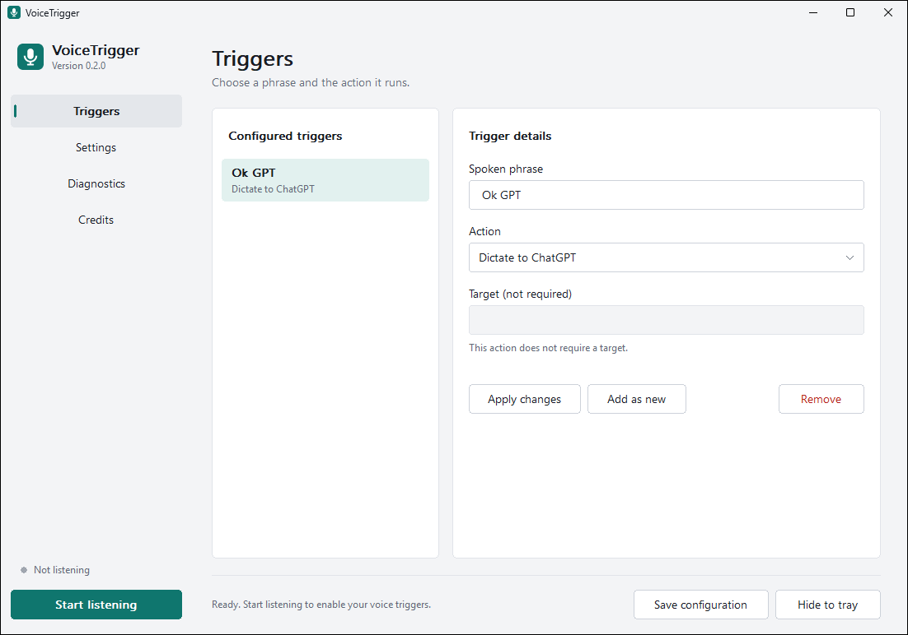
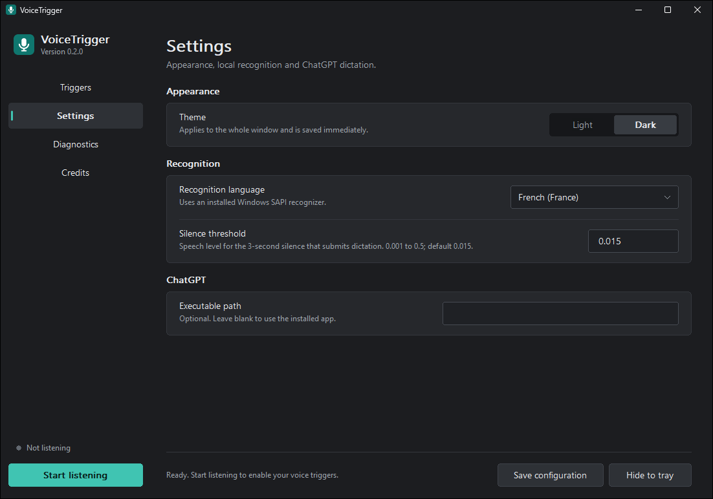

# Desktop interface

VoiceTrigger uses a native, resizable Windows window that reads as a single surface: the title bar takes the theme's background color, and there is no separate menu bar. The left sidebar switches pages and keeps the listening state and the **Start listening** / **Stop listening** button visible on every page. The footer keeps the latest status message, **Save configuration** and **Hide to tray** available across pages.





## Layout and scaling

Every page is computed from one layout plan in logical pixels, which positions the controls and paints their cards, frames and dividers. The content stretches with the window and stays inside it at the minimum size of 960 × 600 logical pixels, the default size of 1100 × 740 and larger or maximized windows. When a monitor's work area is smaller than that minimum, the minimum is reduced so the whole window remains reachable. The layout follows Windows display scaling per monitor.

Button and sidebar labels are centered. Field labels, descriptions and controls share the same margins inside each card. Long trigger rows use word-aware ellipsis; selecting the row exposes the complete phrase in the editor. Descriptions wrap, while the event log, system-check report and license scroll inside their own panels.

## Triggers

The left card lists each configured phrase and its action. Select a row to edit it in **Trigger details**. **Target** is enabled for website and executable actions.

- **Apply changes** updates the selected row in memory.
- **Add as new** creates a separate row from the current fields. Use a distinct phrase.
- **Remove** removes the selected row; at least one trigger must remain.
- **Save configuration** applies the selected row and writes all triggers and settings to the configuration file.

Page navigation retains the editor fields. Apply edits before selecting another trigger. Stop listening before editing or saving; disabled controls and command guards prevent changes to the active configuration.

## Settings

- **Appearance > Theme** switches between **Light** and **Dark**. The theme applies immediately to the whole window, including the title bar and scroll bars, and only this preference is saved at once. Pending trigger or setting edits are not written until **Save configuration**. The theme can be changed while listening.
- **Recognition** contains the installed-engine language and the energy threshold used to detect silence.
- **ChatGPT** contains the optional executable path.

Existing settings and custom trigger phrases are preserved. Configurations without a theme open in the light theme. The dictation sequence and three-second silence interval are unchanged.

## Diagnostics

**Activity** shows the microphone level, the **Live debug** switch and the bounded event log. Frequent level, sound and hypothesis events run only while this view is visible and Live debug is on. Core trigger, action and error events are still recorded in memory when another page is selected. **Clear log** empties that journal.

**System checks** has a **Run checks** button and a separate full report. It inspects installed SAPI engines and accessible ChatGPT controls without starting dictation. See [debugging](debug.md) and [privacy](privacy.md).

## Credits

Credits shows the project version, TheGeogeo attribution, repository/documentation links, open-source libraries and the complete project MIT license, reflowed to the panel width. Version text comes from Cargo package metadata; copyright comes from the repository license. Current library metadata:

| Library | Version | License |
| --- | --- | --- |
| windows-rs (`windows`) | 0.48.0 | MIT OR Apache-2.0 |
| Serde | 1.0.188 | MIT OR Apache-2.0 |
| serde_json | 1.0.105 | MIT OR Apache-2.0 |

## Keyboard

| Shortcut | Action |
| --- | --- |
| Ctrl+1 | Triggers |
| Ctrl+2 | Settings |
| Ctrl+3 | Diagnostics |
| Ctrl+4 | Credits |
| Ctrl+S | Save configuration while stopped |
| Ctrl+Q | Quit (stops listening first) |
| F1 | Credits |
| Tab / Shift+Tab | Move between visible controls |
| Space | Activate a focused button or switch |
| Arrow keys / Alt+Down | Change or open a focused list |

Keyboard focus is shown with an accent outline on buttons, list rows and switches, and an accent border on fields.

Closing or minimizing hides the window in the notification area. Double-click the notification icon to restore it; a maximized window stays maximized. Quit with **Ctrl+Q** or the icon's **Quit** command. Navigation never starts another listener or sends a ChatGPT message.

## Native interface verification

The opt-in desktop test uses a separate configuration and captures only its own native test window. It checks the absence of a menu bar, page retention, add/save/remove, immediate theme persistence that leaves unsaved edits out of the file, the shared listening controls, the Live debug switch, hide/restore and an untruncated diagnostic report. It renders every page in both themes at the default, minimum and a large size, and simulated 125%/150% DPI-change messages:

```powershell
cargo test --release --locked native_pages_preserve_configuration_and_render -- --ignored --test-threads=1 --nocapture
```

It requires an interactive Windows desktop, the French SAPI engine and a microphone. Captures are cropped to the visible window frame and, with the synthetic settings, go under ignored `target/ui-verification/`. It does not use personal settings or send a message. Simulated DPI messages exercise the application's scaling path; they do not replace a real multi-monitor display-scaling test. Ordinary unit tests separately check that no control leaves the window, crosses a card edge or overlaps another control on any page at the tested sizes.
